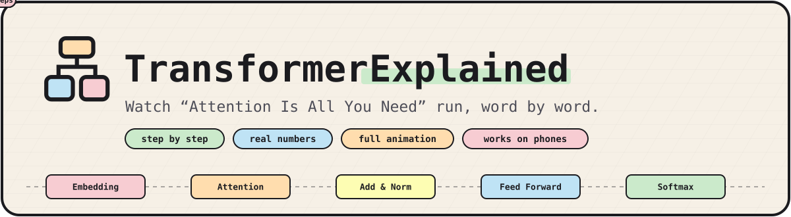
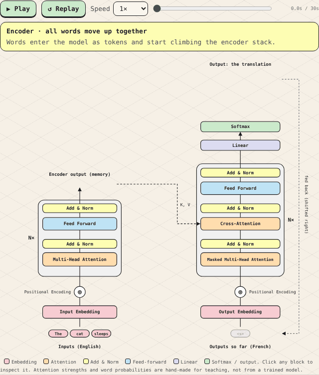
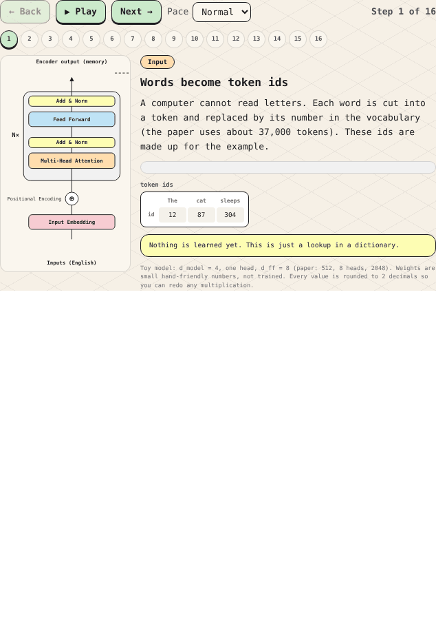
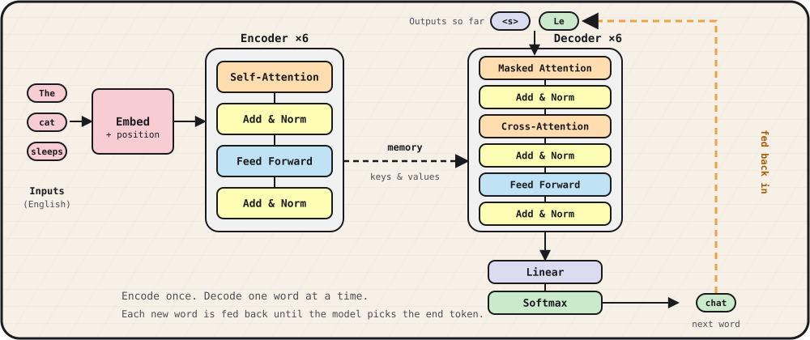
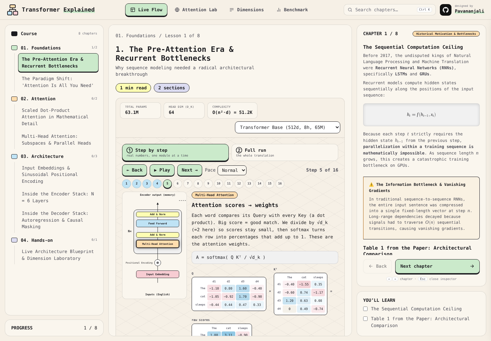
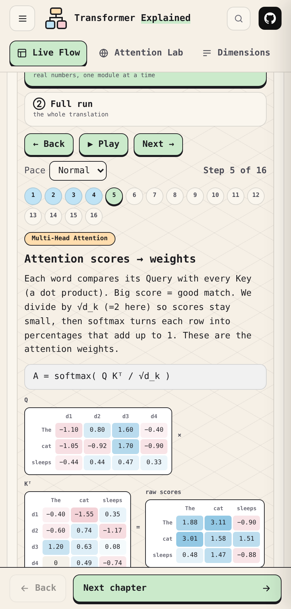
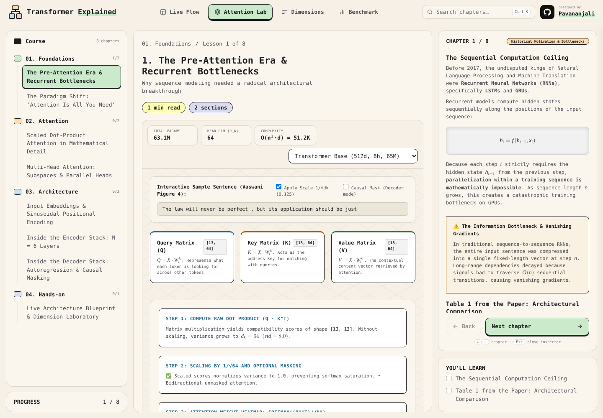
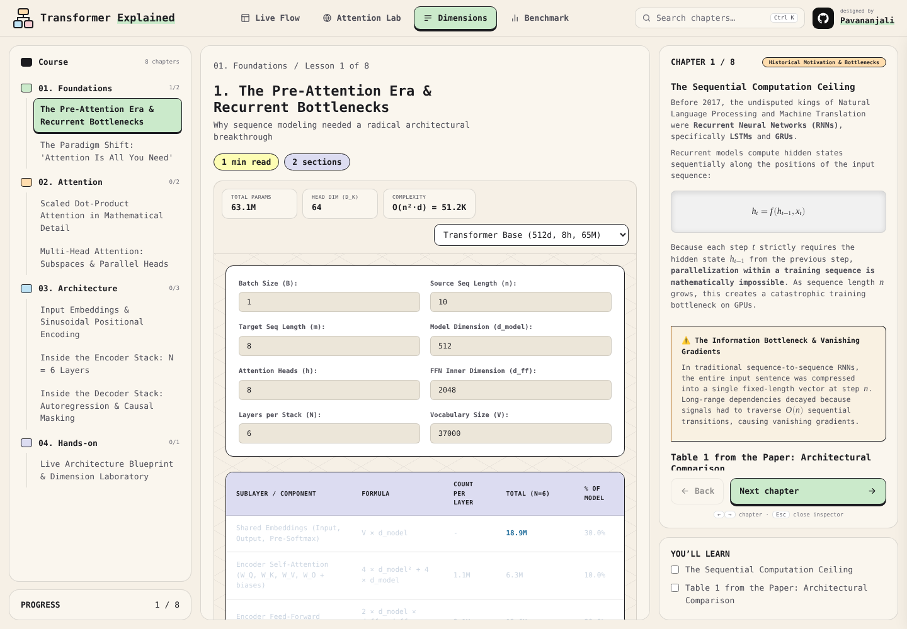
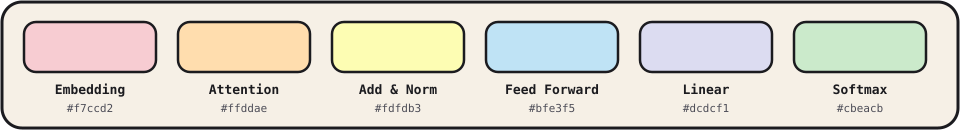

<div align="center">



<br>

**An interactive, animated explainer of the Transformer** (Vaswani et al., NeurIPS 2017).<br>
Words travel up the encoder, the decoder reads them through cross-attention, and the translation appears one word at a time.

<br>


[](https://arxiv.org/abs/1706.03762)

[**Quick tour**](#-quick-tour) ·
[**Step by step**](#-1-step-by-step-follow-the-numbers) ·
[**Full run**](#-2-full-run-the-whole-translation) ·
[**Four views**](#-four-views) ·
[**Run it**](#-run-it) ·
[**Security**](#-security)

<br>



<sub>The sentence <b>“The cat sleeps”</b> climbs the encoder; the decoder then writes <b>“Le chat dort”</b>.</sub>

</div>

---

## ✨ At a glance

<table>
<tr>
<td width="33%" align="center"><h3>🎬<br>Watch it move</h3>Words travel through every block, one stop at a time. Pause, scrub and replay.</td>
<td width="33%" align="center"><h3>🔢<br>See real numbers</h3>16 guided steps with the actual matrices. Redo any multiplication by hand.</td>
<td width="33%" align="center"><h3>🧠<br>Understand attention</h3>Arcs show who looks at whom. The mask and cross-attention are drawn, not just described.</td>
</tr>
<tr>
<td align="center"><h3>🧪<br>Play in the lab</h3>Type your own sentence and change model sizes to see shapes and parameters update.</td>
<td align="center"><h3>📱<br>Any screen</h3>Three columns on desktop, a slide-in menu and a sticky Back / Next bar on phones.</td>
<td align="center"><h3>🔒<br>Safe by design</h3>Static site, escaped input, strict content policy and hardened headers.</td>
</tr>
</table>

## 🎯 Why it exists

The Transformer paper is a dense read with one famous diagram. The diagram is *static*, but the model is a **process**.

| 😵 What readers struggle with | 📄 What the paper gives you | 👀 What this site shows |
| :-- | :-- | :-- |
| Where does a word go, and in what order? | Boxes and arrows (Figure 1) | A word *moving* through every block |
| What does “every word looks at every word” mean? | `softmax(QKᵀ/√d_k)V` | Arcs between words, thicker for stronger attention |
| Why does the decoder only look backwards? | One sentence about masking | The mask drawn as arcs that only point to earlier words |
| How does the decoder use the encoder? | A line between the two halves | Orange lines from each source word to the word being written |
| How is text generated? | “Auto-regressive” | A word is chosen, written, and **fed back in** |
| Why is attention faster to train than an RNN? | Table 1 | A Benchmark view to compare with the animation |

> Static pictures show *structure*. Motion shows *order, cause and flow*, which is what people most often get wrong.

## 🎞️ Quick tour

<table>
<tr>
<td width="50%" align="center"><br><b>① Step by step</b><br><sub>16 modules, real numbers at every stage</sub></td>
<td width="50%" align="center"><br><b>② Full run</b><br><sub>The whole translation in one animation</sub></td>
</tr>
</table>

### 🔢 1. Step by step: follow the numbers

One module at a time, like a short video that you control. Each step shows **where** you are in the architecture (the highlighted block), **what** happens in plain words, the **formula**, and then reveals the real matrices in order: *input → operation → result*. It auto-plays, and you can pause, go back, change the pace or jump to any step. Press **⛶ Fullscreen** (or `F`) for a big-screen view, handy for teaching or demos.

The numbers come from a **tiny but real Transformer** (`model.js`): `d_model = 4`, one head, `d_ff = 8`. Every value is computed by the page and rounded to 2 decimals at each stage. Each step prints one worked example, such as:

```
Q[The, d1] = (−0.20)×0.50 + 0.80×(−0.50) + (−0.80)×0 + 0.60×(−1) = −1.10
```

<details>
<summary><b>📋 See all 16 steps</b></summary>

<br>

| # | Module | What happens to the numbers |
| :-: | :-- | :-- |
| 1 | Tokens | Words become integer ids |
| 2 | Embedding | Each id picks a row (a vector) from a table, then × √d_model |
| 3 | Positional encoding | A sine/cosine fingerprint per position is added |
| 4 | Self-attention: Q, K, V | The input is multiplied by three weight matrices |
| 5 | Scores → weights | Q·Kᵀ, divide by √d_k, softmax to rows that sum to 1 |
| 6 | Blend the values | Weights × V gives context-aware vectors |
| 7 | Add & Norm | Residual add, then LayerNorm (mean 0, spread 1) |
| 8 | Feed-forward | Expand, ReLU zeroes negatives, shrink back |
| 9 | Add & Norm → memory | The encoder output |
| 10 | Decoder input | `<s>`, `Le` are embedded and positioned |
| 11 | Masked self-attention | Future positions become −∞, so softmax gives exactly 0 |
| 12 | Cross-attention | Queries from the decoder, keys and values from the encoder memory |
| 13 | Feed-forward + Add & Norm | The decoder's last vector `h` is ready |
| 14 | Linear | `h` is scored against every word in the vocabulary |
| 15 | Softmax | Scores become probabilities and “chat” wins |
| 16 | Feedback | The word is appended and the decoder runs again |

</details>

> **Honest note.** The toy weights are small hand-friendly numbers, not trained ones, and the output row for “chat” was set so the example lands on a sensible word. Real models learn all of this from data. The maths itself (dot products, softmax, residuals, LayerNorm, ReLU) is exactly what a real Transformer does.

### 🎬 2. Full run: the whole translation

The continuous animation: encode once, then decode one word at a time. Play, pause, replay, change speed, scrub the timeline, click any block to open its inspector, and go **⛶ Fullscreen** (or press `F`) to fill the screen.

<div align="center">



</div>

1. **Encoder pass.** The three source words enter together, get an embedding and a position, and climb the stack. At the attention block they link to each other. They end as the *encoder output (memory)*.
2. **Decoder steps.** For each target word the decoder starts from what it has written so far, applies masked self-attention, reads the memory through cross-attention, then Linear and Softmax give a probability for each candidate word.
3. **Feedback.** The winning word goes to the output and travels back to the decoder's input. This is auto-regression.

> **Honest note.** In the *Full run*, attention strengths and word probabilities are **hand-written to teach the idea**, not read from a trained model. The *Step by step* mode uses real computed numbers from the toy model instead, so the two modes show different values.

## 🖥️ Four views

| View | What it does |
| :-- | :-- |
| 🎬 **Live Flow** | Step by step and Full run, described above |
| 🔬 **Attention Lab** | Type your own sentence and see Q, K, V and the attention matrix, with the √d_k scale and the causal mask as toggles |
| 📐 **Dimensions** | Change model dimensions and see tensor shapes and parameter counts update. Presets: Base, Big, GPT-2 Small, Tiny |
| 📊 **Benchmark** | Table 1 of the paper (complexity, sequential operations, path length) with example numbers |

<table>
<tr>
<td width="50%" align="center"><br><sub><b>Desktop</b>: chapters, module and notes side by side</sub></td>
<td width="50%" align="center"><br><sub><b>Phone</b>: one column, Back / Next fixed to the bottom</sub></td>
</tr>
<tr>
<td align="center"><br><sub><b>Attention Lab</b></sub></td>
<td align="center"><br><sub><b>Dimensions</b></sub></td>
</tr>
</table>

### 📚 Eight chapters

| | | |
| :-- | :-- | :-- |
| **1** The pre-attention era and recurrent bottlenecks | **2** The paradigm shift | **3** Scaled dot-product attention |
| **4** Multi-head attention | **5** Embeddings and positional encoding | **6** The encoder stack |
| **7** The decoder stack and causal masking | **8** Live architecture and dimension laboratory | |

## 🎨 Colours from the paper

Every block uses the pastel fill from Figure 1 of the paper, so the site reads like the diagram you already know.

<div align="center"></div>

## 🚀 Run it

No install, no build.

```bash
python -m http.server 8080      # then open http://localhost:8080
# or
npx serve .
```

You can also open `index.html` directly. Maths (KaTeX) and fonts load from a CDN, so you need to be online for them.

| Key | Action |
| :-: | :-- |
| `←` `→` or `[` `]` | Previous / next chapter |
| `Ctrl` + `K` | Focus the search box |
| `Esc` | Close the inspector, the mobile menu or fullscreen |
| `F` | Toggle fullscreen for Live Flow |
| `←` `→` / `Space` *(in fullscreen)* | Previous / next step, play / pause |

<details>
<summary><b>🌐 Deploy it</b></summary>

<br>

- **Vercel:** import the repository, framework preset *Other*, no build command. `vercel.json` is picked up automatically.
- **GitHub Pages:** Settings → Pages → deploy from the main branch. Pages cannot set the headers in `vercel.json`; the in-page policy still applies.

</details>

<details>
<summary><b>🗂️ Project structure</b></summary>

```
.
├── index.html       page shell: top bar, chapter tree, lesson, step panel
├── styles.css       theme, layout, responsive rules
├── app.js           chapters, state, views, inspector, search
├── model.js         the tiny real Transformer maths (pure functions, easy to test)
├── steps.js         the guided step-by-step player
├── flow.js          the full-run animation and the mode switch
├── vercel.json      security headers for Vercel
├── favicon.svg, favicon.ico, apple-touch-icon.png, site.webmanifest, icons/
├── docs/            README images: banner, pipeline, palette, GIFs, screenshots
└── PAPER.pdf        the original paper
```

</details>

<details>
<summary><b>📐 Paper cheat sheet</b></summary>

<br>

| Hyperparameter | Base | Big |
| :-- | :-: | :-: |
| Layers `N` | 6 | 6 |
| `d_model` | 512 | 1024 |
| `d_ff` | 2048 | 4096 |
| Heads `h` | 8 | 16 |
| `d_k = d_v` | 64 | 64 |
| Parameters (paper, Table 3) | 65M | 213M |

| Layer type | Complexity per layer | Sequential ops | Max path length |
| :-- | :-: | :-: | :-: |
| Self-attention | O(n² · d) | O(1) | O(1) |
| Recurrent | O(n · d²) | O(n) | O(n) |
| Convolutional | O(k · n · d²) | O(1) | O(log_k n) |
| Self-attention (restricted) | O(r · n · d) | O(1) | O(n / r) |

```
Attention(Q, K, V) = softmax(Q Kᵀ / √d_k) V
PE(pos, 2i)   = sin(pos / 10000^(2i/d_model))
PE(pos, 2i+1) = cos(pos / 10000^(2i/d_model))
```

</details>

## 🔒 Security

The site is static: no server code, no database, no accounts.

<details>
<summary><b>What is protected</b></summary>

<br>

- **No HTML injection.** The sentence typed in the Attention Lab is escaped before display and limited to 120 characters.
- **Content Security Policy** in `index.html`: scripts only from this site and the KaTeX host, no network requests from page code, no plugins, no forms.
- **`vercel.json`** adds stricter headers: frame blocking, `nosniff`, no referrer, a locked-down permissions policy and HSTS.
- External links use `rel="noopener noreferrer"`.
- Possible next step: pin the KaTeX files with Subresource Integrity hashes, or host them yourself.

</details>

## 🗺️ Roadmap

- [ ] 🌙 Dark mode
- [ ] 🧩 Heads view: watch each of the 8 heads attend differently
- [ ] ⌨️ Type your own source sentence into Live Flow
- [ ] 🔀 Show several heads side by side in the step-by-step mode
- [ ] 💾 Download every matrix as CSV
- [ ] 🧠 Real attention weights from a small trained model

## 📖 Reference

Vaswani, A., Shazeer, N., Parmar, N., Uszkoreit, J., Jones, L., Gomez, A. N., Kaiser, Ł., Polosukhin, I. (2017). *Attention Is All You Need.* NeurIPS 2017. [arXiv:1706.03762](https://arxiv.org/abs/1706.03762)

<details>
<summary><b>BibTeX</b></summary>

```bibtex
@inproceedings{vaswani2017attention,
  title     = {Attention Is All You Need},
  author    = {Vaswani, Ashish and Shazeer, Noam and Parmar, Niki and Uszkoreit, Jakob and Jones, Llion and Gomez, Aidan N. and Kaiser, Lukasz and Polosukhin, Illia},
  booktitle = {Advances in Neural Information Processing Systems},
  year      = {2017}
}
```

</details>

---

<div align="center">

### Designed and built by [**Pavananjali**](https://github.com/Anjaliavv51/visualizing-transformer)

If this helped you understand the Transformer, a ⭐ on the repo means a lot.

<sub>Layout inspired by <a href="https://designed-to-scale.vercel.app/">designed-to-scale</a>. Figure colours from the original paper, whose figures Google permits to be reproduced for scholarly work with attribution.</sub>

</div>
