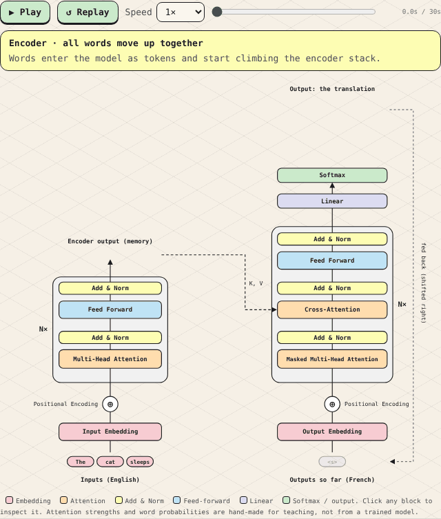
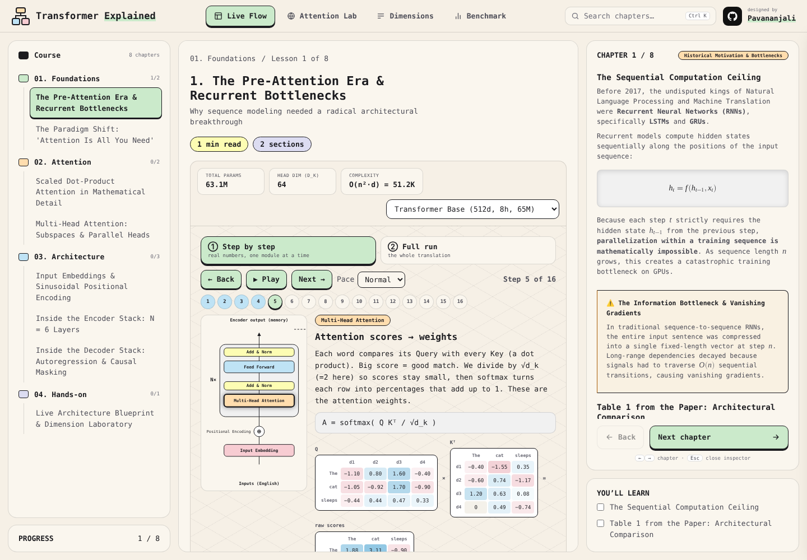
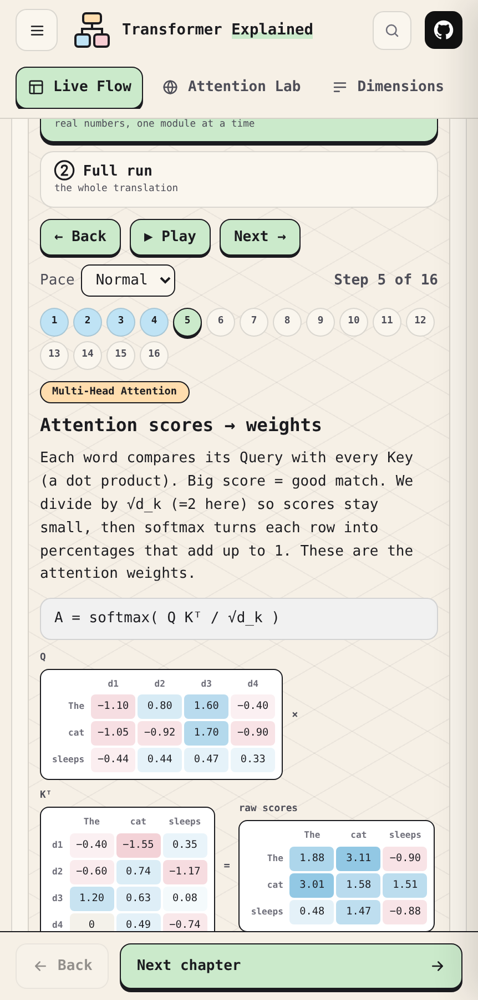
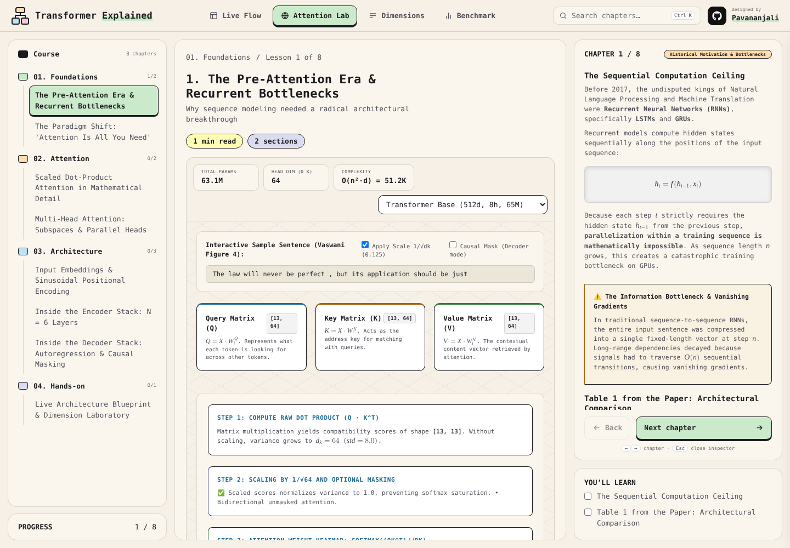
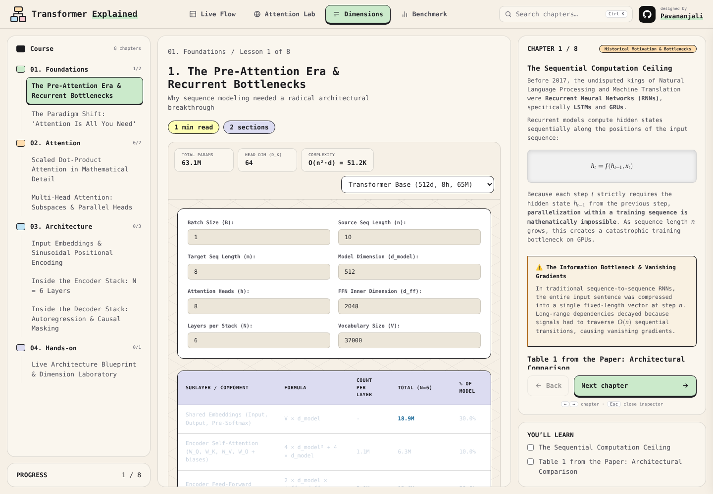
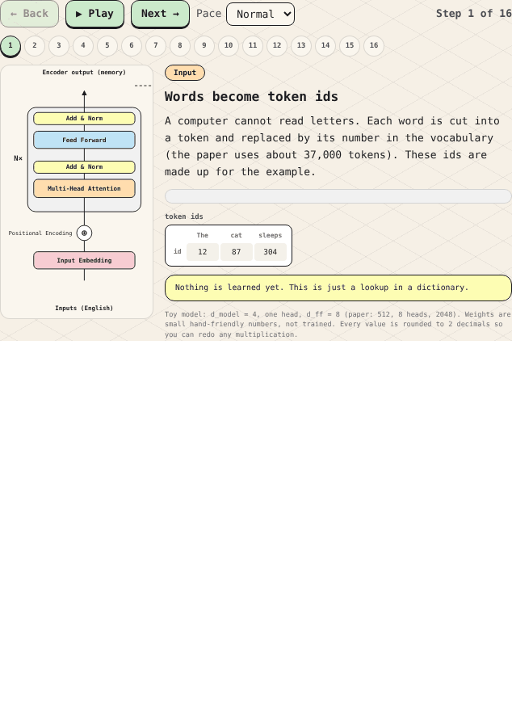

<div align="center">

# Transformer Explained

### Watch *Attention Is All You Need* run, word by word.

An interactive, animated explainer of the Transformer (Vaswani et al., NeurIPS 2017).
Words travel up the encoder, the decoder reads them through cross-attention, and the translation appears one word at a time.



**Plain HTML, CSS and JavaScript. No build step. No backend. Works on phones.**

Designed by [**Pavananjali**](https://github.com/Anjaliavv51/visualizing-transformer)

</div>

---

## Why this exists

The Transformer paper is a dense read with one famous diagram. The diagram is *static*, but the model is a **process**. This site turns the paper's Figure 1 into something you can watch, pause, scrub and replay.

| What readers struggle with | What the paper gives you | What this site shows |
| :-- | :-- | :-- |
| Where does a word go, and in what order? | Boxes and arrows (Figure 1) | A word *moving* through every block, one stop at a time |
| What does "every word looks at every word" mean? | `softmax(QKᵀ/√d_k)V` | Arcs between words, thicker where attention is stronger |
| Why does the decoder only look backwards? | A sentence about masking | The mask drawn as arcs that only point to earlier words |
| How does the decoder use the encoder? | A line from encoder to decoder | Orange lines from each source word to the word being written |
| How is text generated? | "Auto-regressive" | A word is chosen, written to the output, and **fed back in** |
| Why is attention faster to train than an RNN? | Table 1 | A Benchmark view to compare with the animation |

Static pictures show *structure*. Motion shows *order, cause and flow*, which is what people most often get wrong.

## What you will see

<table>
<tr>
<td width="50%"></td>
<td width="50%"></td>
</tr>
<tr>
<td align="center"><sub>Desktop: chapters on the left, animation in the middle, notes on the right</sub></td>
<td align="center"><sub>Phone: one column, Back and Next fixed to the bottom</sub></td>
</tr>
</table>

### The four views

| View | What it does |
| :-- | :-- |
| **Live Flow** | Two modes. **Step by step** walks through 16 modules one at a time with the real numbers at every stage. **Full run** plays the whole translation of *"The cat sleeps"* into *"Le chat dort"* as one animation. |
| **Attention Lab** | Type your own sentence and see Q, K, V and the attention matrix, with the √d_k scale and the causal mask as toggles. |
| **Dimensions** | Change model dimensions and see tensor shapes and parameter counts update. Presets: Base, Big, GPT-2 Small, Tiny. |
| **Benchmark** | Table 1 of the paper (complexity, sequential operations, path length) with example numbers. |

<table>
<tr>
<td></td>
<td></td>
</tr>
</table>

The site has **eight chapters** that walk from the limits of recurrent networks, through scaled dot-product and multi-head attention, positional encoding, the encoder and decoder stacks, to a hands-on laboratory.

## Two ways to watch

### 1. Step by step: follow the numbers (default)

<div align="center"></div>

One module at a time, like a short video that you control. Each step shows **where** you are in the architecture (the highlighted block), **what** happens in plain words, the **formula**, and then reveals the real matrices in order: *input → operation → result*. It auto-plays, and you can pause, go back, change the pace, or jump to any step.

The numbers come from a **tiny but real Transformer** (`model.js`): `d_model = 4`, one head, `d_ff = 8`. Every value is computed by the page, rounded to 2 decimals at each stage, so you can redo any multiplication by hand. Each step also prints one worked calculation, for example `Q[The, d1] = (−0.20)×0.50 + 0.80×(−0.50) + (−0.80)×0 + 0.60×(−1) = −1.10`.

| # | Module | What happens to the numbers |
| :-: | :-- | :-- |
| 1 | Tokens | Words become integer ids |
| 2 | Embedding | Each id picks a row (a vector) from a table, then × √d_model |
| 3 | Positional encoding | A sine/cosine fingerprint per position is added |
| 4 | Self-attention: Q, K, V | The input is multiplied by three weight matrices |
| 5 | Scores → weights | Q·Kᵀ, divide by √d_k, softmax to rows that sum to 1 |
| 6 | Blend the values | Weights × V gives context-aware vectors |
| 7 | Add & Norm | Residual add, then LayerNorm (mean 0, spread 1) |
| 8 | Feed-forward | Expand, ReLU zeroes negatives, shrink back |
| 9 | Add & Norm → memory | The encoder output |
| 10 | Decoder input | `<s>`, `Le` are embedded and positioned |
| 11 | Masked self-attention | Future positions become −∞, so softmax gives exactly 0 |
| 12 | Cross-attention | Queries from the decoder, keys and values from the encoder memory |
| 13 | Feed-forward + Add & Norm | The decoder's last vector `h` is ready |
| 14 | Linear | `h` is scored against every word in the vocabulary |
| 15 | Softmax | Scores become probabilities and "chat" wins |
| 16 | Feedback | The word is appended and the decoder runs again |

> **Honest note:** the toy weights are small hand-friendly numbers, not trained ones, and the output row for "chat" was set so the example lands on a sensible word. Real models learn all of this from data. The maths itself (dot products, softmax, residuals, LayerNorm, ReLU) is exactly what a real Transformer does.

### 2. Full run: see the whole flow at once

<div align="center"></div>

The continuous animation described below.

## How the full run works

```mermaid
flowchart LR
    A["Inputs: The cat sleeps"] --> B[Embedding + position]
    B --> C["Encoder x N: self-attention, add & norm, feed-forward"]
    C -->|"keys and values"| E
    D["Outputs so far: start token"] --> D2[Embedding + position]
    D2 --> D3[Masked self-attention]
    D3 --> E[Cross-attention]
    E --> F[Feed-forward]
    F --> G[Linear]
    G --> H[Softmax]
    H --> I["Next word: Le"]
    I -.->|fed back| D
```



1. **Encoder pass (0 to 6 s).** The three source words enter together, get an embedding and a position, then climb the stack. At the attention block they link to each other. They end as the *encoder output (memory)*.
2. **Decoder steps (4 steps of 6 s).** For each target word the decoder starts from what it has written so far, applies masked self-attention, reads the memory through cross-attention, then Linear and Softmax give a probability for each candidate word.
3. **Feedback.** The winning word goes to the output row and travels back to the decoder's input. This is auto-regression.

> **Honest note:** in the *Full run*, the attention strengths and word probabilities are **hand-written to teach the idea**. They are not read from a trained model. (The *Step by step* mode uses real computed numbers from the toy model instead, so the two modes show different values.)

In the full run, everything is drawn from a single clock, so Play, Pause, Replay, speed and the timeline slider always agree. Motion is reduced when your system asks for it (`prefers-reduced-motion`).

## Paper cheat sheet

| Hyperparameter | Base | Big |
| :-- | :-: | :-: |
| Layers `N` | 6 | 6 |
| `d_model` | 512 | 1024 |
| `d_ff` | 2048 | 4096 |
| Heads `h` | 8 | 16 |
| `d_k = d_v` | 64 | 64 |
| Parameters (paper, Table 3) | 65M | 213M |

| Layer type | Complexity per layer | Sequential ops | Max path length |
| :-- | :-: | :-: | :-: |
| Self-attention | O(n² · d) | O(1) | O(1) |
| Recurrent | O(n · d²) | O(n) | O(n) |
| Convolutional | O(k · n · d²) | O(1) | O(log_k n) |
| Self-attention (restricted) | O(r · n · d) | O(1) | O(n / r) |

```
Attention(Q, K, V) = softmax(Q Kᵀ / √d_k) V
PE(pos, 2i)   = sin(pos / 10000^(2i/d_model))
PE(pos, 2i+1) = cos(pos / 10000^(2i/d_model))
```

## Design

* **Layout** follows the two-pane "course" pattern of [designed-to-scale](https://designed-to-scale.vercel.app/): top bar, chapter tree, lesson with a live stage, and a step panel with Back and Next.
* **Colours** come from Figure 1 of the paper: yellow for *Add & Norm*, blue for *Feed Forward*, orange for *Attention*, pink for *Embeddings*, green for *Softmax*, lavender for *Linear*.
* **Responsive.** Three columns on desktop. On tablets and phones the chapter tree becomes a slide-in menu and Back / Next stick to the bottom of the screen.
* **Accessible.** Visible keyboard focus, blocks open with Enter or Space, reduced motion respected.

## Run it

No install, no build.

```bash
python -m http.server 8080      # then open http://localhost:8080
# or
npx serve .
```

You can also open `index.html` directly. Maths (KaTeX) and fonts load from a CDN, so you need to be online for them.

| Key | Action |
| :-: | :-- |
| `←` `→` or `[` `]` | Previous / next chapter |
| `Ctrl` + `K` | Focus the search box |
| `Esc` | Close the inspector or the mobile menu |

## Project structure

```
.
├── index.html     page shell: top bar, chapter tree, lesson, step panel
├── css/
│   └── styles.css theme, layout, responsive rules
├── js/
│   ├── app.js     chapters, state, views, inspector, search
│   ├── flow.js    the full-run animation and the mode switch
│   ├── model.js   the tiny real Transformer maths (pure functions, easy to test)
│   └── steps.js   the guided step-by-step player
├── images/
│   ├── attention-lab.png
│   ├── desktop.png
│   ├── dimensions.png
│   ├── flow.gif
│   ├── mobile.png
│   └── steps.gif
└── docs/
    ├── PAPER.pdf  the original paper
    └── README.md  project documentation & walkthrough
```

## Security

The site is static: no server code, no database, no accounts.

* **No HTML injection.** The sentence typed in the Attention Lab is escaped before display and limited to 120 characters.
* **Content Security Policy** in `index.html`: scripts only from this site and the KaTeX host, no network requests from page code, no plugins, no forms.
* **`vercel.json`** adds stricter headers: frame blocking, `nosniff`, no referrer, a locked-down permissions policy and HSTS.
* External links use `rel="noopener noreferrer"`.

Possible next step: pin the KaTeX files with Subresource Integrity hashes, or host them yourself.

## Deploy

* **Vercel:** import the repository, framework preset *Other*, no build command. `vercel.json` is picked up automatically.
* **GitHub Pages:** Settings, Pages, deploy from the main branch. Pages cannot set the headers in `vercel.json`; the in-page policy still applies.

## Roadmap

- [ ] Dark mode
- [ ] Heads view: watch each of the 8 heads attend differently
- [ ] Let people type their own source sentence into Live Flow
- [ ] Show several heads side by side in the step-by-step mode
- [ ] Offer a download of every matrix as CSV
- [ ] Real attention weights from a small trained model

## References

Vaswani, A., Shazeer, N., Parmar, N., Uszkoreit, J., Jones, L., Gomez, A. N., Kaiser, Ł., Polosukhin, I. (2017). *Attention Is All You Need.* NeurIPS 2017. [arXiv:1706.03762](https://arxiv.org/abs/1706.03762)

```bibtex
@inproceedings{vaswani2017attention,
  title     = {Attention Is All You Need},
  author    = {Vaswani, Ashish and Shazeer, Noam and Parmar, Niki and Uszkoreit, Jakob and Jones, Llion and Gomez, Aidan N. and Kaiser, Lukasz and Polosukhin, Illia},
  booktitle = {Advances in Neural Information Processing Systems},
  year      = {2017}
}
```

## Credits

Designed and built by **[Pavananjali](https://github.com/Anjaliavv51)**.
